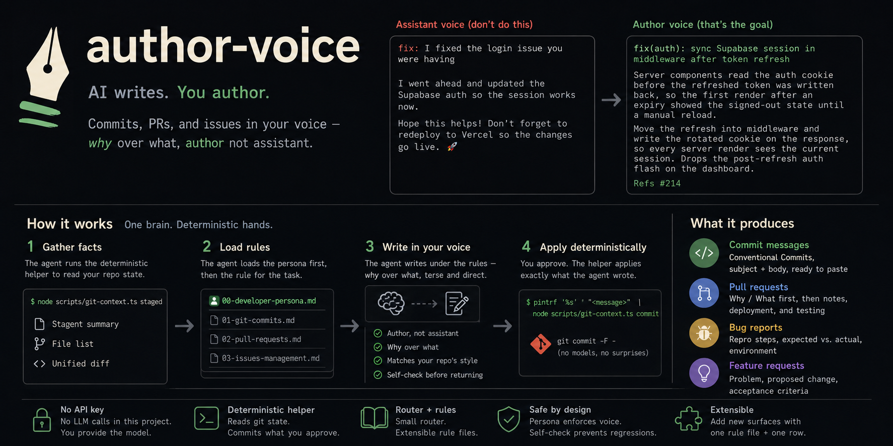

<p align="center">
  
</p>

# author-voice

An agent skill that makes AI-authored commits, PRs, and issues read in the
developer's own voice — not like an assistant talking to you.

It is a set of Markdown rules an AI agent loads before it writes version-control
text, plus a small deterministic Git helper. **There is no API key and no LLM
call in this project.** The agent you already use — Claude Code, Cursor, or any
tool that loads skills — *is* the model. This skill just changes how it writes.

## The problem

When an AI agent writes your Git history, it writes like an assistant:

```
fix: I fixed the login issue you were having

I went ahead and updated the Supabase auth so the session works now.
Hope this helps! Don't forget to redeploy to Vercel so the changes go live. 🚀
```

It addresses *you*, narrates the act of helping, offers more work, nags about
deployment, and never explains the actual cause. It does not sound like the
person whose name is on the commit.

`author-voice` strips that out. The agent stops being an assistant and becomes
the author — terse, first-person or imperative, explaining *why* when the diff
can't, and silent when the diff already speaks:

```
fix(auth): sync Supabase session in middleware after token refresh

Server components read the auth cookie before the refreshed token was
written back, so the first render after an expiry showed the signed-out
state until a manual reload.

Move the refresh into middleware and write the rotated cookie on the
response, so every server render sees the current session. Drops the
post-refresh auth flash on the dashboard.

Refs #214
```

## How it works

The skill is a **router plus rule files**, with one deterministic helper script.

```
skills/author-voice/                      # the installable skill package
├── SKILL.md                              # Router: global contract + intent table
├── .agent-skills/
│   ├── 00-developer-persona.md           # The voice — loaded before every task
│   ├── 01-git-commits.md                 # Conventional Commits rules + examples
│   ├── 02-pull-requests.md               # PR structure, Why/What over diff replay
│   └── 03-issues-management.md           # Bug report + feature request templates
└── scripts/
    └── git-context.ts                    # Deterministic Git plumbing (no LLM)
```

The flow has exactly one brain — the agent:

1. The agent runs `git-context.ts` to read the staged diff (or the branch diff).
2. It loads `00-developer-persona.md` plus the matching rule file and writes the
   commit / PR / issue under those rules, in your voice.
3. For commits, after you approve it, the agent pipes the message back through
   `git-context.ts commit`, which runs `git commit -F -`.

The helper calls no model and writes no prose. It only gathers facts for the
rules and applies the text the agent produced — so the language is always the
agent's, governed by the skill, and the Git plumbing is always deterministic.

- **`SKILL.md`** maps intent to a rule file: a `git commit` routes to commits,
  `gh pr create` to pull requests, `gh issue create` to issues. It defines the
  global contract every route inherits and a self-check the agent runs before
  returning anything.
- **`00-developer-persona.md`** is a hard dependency loaded first, every time. It
  defines *who is speaking* — two allowed voices (first-person `I`/`We`, or bare
  imperative `Fix`/`Add`/`Refactor`) — and a banned-vocabulary list that kills
  assistant tone: `I'll help you`, `I suggest`, `feel free to`,
  `Don't forget to deploy to Vercel`, robot emoji, and tooling self-attribution.
- **`01`–`03`** add *format* on top of that *voice*: Conventional Commits for
  commits, a `Why / What / Notes / Deployment notes / Testing` structure for PRs,
  and reproducible Bug Report / Feature Request templates for issues.

## Requirements

- An AI agent that loads skills (e.g. Claude Code).
- **Node ≥ 23.6** to run the helper, which executes TypeScript natively. On older
  Node, run it through [`tsx`](https://github.com/privatenumber/tsx) instead.
- **No npm install is needed to use the skill** — the helper has zero runtime
  dependencies. `npm install` is only for contributors who want to typecheck.

## Installation

Install with the [`skills`](https://github.com/vercel-labs/skills) CLI. It
fetches the skill directory and drops it into your agent's `skills/` folder — no
clone, no `npm install`.

**For all your projects** (global, installs to `~/.claude/skills/`):

```bash
npx skills add https://github.com/seven-317/author-voice/tree/main/skills/author-voice -g
```

**For one project only** (installs to `./.claude/skills/`, committable with your
team):

```bash
npx skills add https://github.com/seven-317/author-voice/tree/main/skills/author-voice
```

The CLI targets Claude Code, OpenCode, Codex, Cursor, and more; pass `-a` to pick
one (e.g. `-a claude-code`) or it will prompt. The agent then discovers the skill
by the `name: author-voice` field in `SKILL.md`.

The helper ships inside the skill, so it runs from wherever the skill was
installed — but it operates on whatever repository your shell is currently in. The
script can live under `~/.claude/skills/author-voice/` while it reads and commits
*your project's* changes:

```bash
node ~/.claude/skills/author-voice/scripts/git-context.ts staged
```

### Without the CLI

Clone the repo and point an agent at the file directly:

```bash
git clone https://github.com/seven-317/author-voice.git
```

> Read `skills/author-voice/SKILL.md` and write the commit for my staged changes.

### Verify

```bash
node --version   # expect v23.6.0 or newer (the helper runs TypeScript natively)
```

## Usage

Once installed, work as usual. When you stage changes, open a PR, or file an
issue, ask the agent for it — it loads the persona and the matching rule file and
produces the artifact in your voice.

The agent drives the helper for you, but you can run it directly too (paths shown
relative to the skill directory; run from inside the target repo):

```bash
node scripts/git-context.ts staged              # staged summary + diff
node scripts/git-context.ts branch --base main  # branch log + diff for a PR
printf '%s' "<message>" | node scripts/git-context.ts commit  # apply a message
```

`staged` exits non-zero and tells you to `git add` when nothing is staged.
`commit` reads the message from stdin and runs `git commit -F -`, so multi-line
bodies need no shell quoting.

## Design principles

- **Author, not assistant.** There is no "you" on the other side of a commit
  message. The agent writes for the repository's history and the next reader.
- **One brain, deterministic hands.** The agent writes every word; the helper
  only reads state and commits. No model, no API key, no hidden second LLM.
- **Why over what.** Commits and PRs lead with the reasoning the diff can't
  carry. The code shows *what* changed; the message exists for *why*.
- **Match the house style.** Before imposing any format, the agent reads recent
  `git log` and `.github/` templates. The repo's existing convention wins; the
  persona applies on top of it.
- **Small router, extensible rules.** Adding a new surface (a changelog, a
  release note) means a new `.agent-skills/NN-*.md` file and one row in the
  router table — not a rewrite.

## What it covers

| Task             | Routes to                            | Produces                                            |
| ---------------- | ------------------------------------ | --------------------------------------------------- |
| Commit message   | `01-git-commits.md`                  | Conventional Commit, subject + body, ready to paste |
| Pull request     | `02-pull-requests.md`                | Title + Markdown body, Why/What first               |
| Bug report       | `03-issues-management.md`            | Repro steps, expected vs. actual, environment       |
| Feature request  | `03-issues-management.md`            | Problem, proposed change, acceptance criteria       |

## Contributing

New surfaces (release notes, changelogs, review comments) drop in as one rule
file plus one router row. See [CONTRIBUTING.md](CONTRIBUTING.md) for the
architecture invariants, the dev setup, and how to extend the skill or the helper
without breaking the router.

## License

See [LICENSE](LICENSE).
